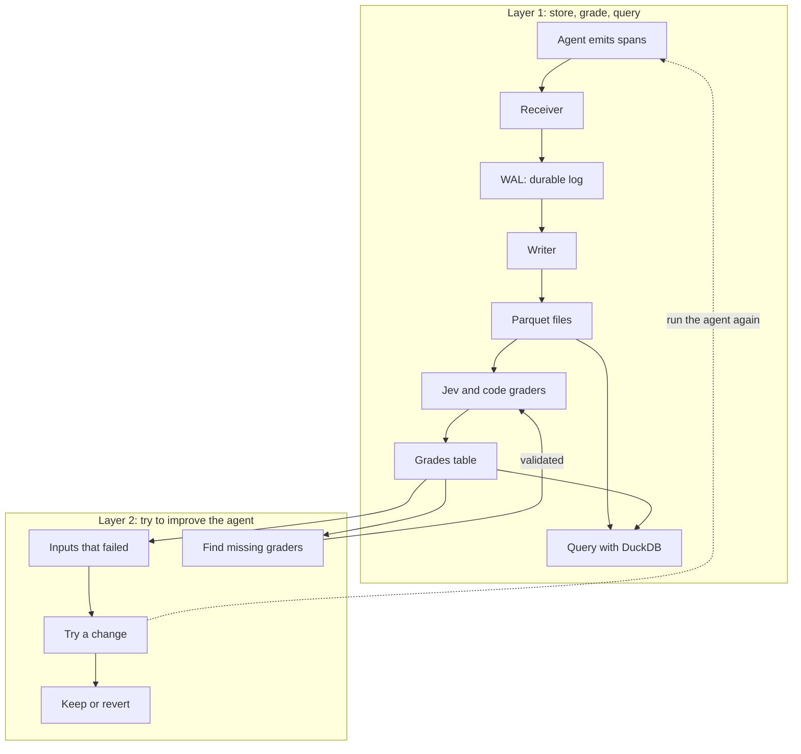

# hopper-mini

I want to use this repo to explore a mini trace ingestion stack for agents. An agent does some work, makes model and tool calls, and emits spans. The spans from one request make up a trace.

This is all a mini version of what an actual production system might do. The idea is to run it on a laptop and understand how the pieces fit together.

## How it fits together



## Layer 1: store, grade, query

The basic flow is:

1. The agent sends its spans to an endpoint using OpenTelemetry.
2. The receiver writes each upload to a write-ahead log, or WAL, and acknowledges it once it is on disk.
3. The writer reads the log, turns spans into rows, and writes batches to Parquet files.
4. DuckDB reads those files so we can query a whole trace, look at tool calls, or find errors.
5. Jev and code graders look at finished traces and write their answers to a separate grades table.

The log keeps the original uploads so we can replay them. Parquet gives us compressed files that DuckDB can query directly.

## Why keep grades separately?

I want to see whether we can grade traces once and then search using those grades. For example, show me traces where the agent answered the question but made claims its sources do not support.

Graders ask questions about the trace and record `yes`, `no`, or `unsure`. A trace with no grade yet is still ungraded. We check the graders against labels before using them to judge agent changes.

Grades live in a separate table. Adding a grader means adding rows, without rewriting all the span files.

## Layer 2: try a change and see if it helps

Take inputs from traces that got bad grades and save them as an eval set. Change a prompt or some tool text, run those inputs again, and let the same graders judge the results. Use that to decide whether to keep the change or revert it.

We also look for mistakes the current graders missed. Those can become new grader questions, which we check before using them.

Every rerun goes through the same receiver, log, writer, and graders. A separate answer-key checker helps us see whether better grades actually mean better answers.

## Receive traces

Run the OTLP/HTTP receiver in the foreground:

```sh
hopper ingest serve
hopper ingest serve --fsync per-request
hopper ingest serve --full-fsync
```

`--full-fsync` uses macOS `F_FULLFSYNC`. The default uses group commit. `HOPPER_ENDPOINT` defaults to `http://127.0.0.1:4318` and must be an HTTP loopback origin.

To run the receiver and writer under local supervision, use:

```sh
hopper stack up
hopper stack status
hopper stack down
```

These commands print JSON with `receiver_pid` and `writer_pid`. `up` waits for both children to become ready. A failed first start cleans up the supervisor. After startup, each crashed child restarts independently with a retry delay capped at one second. `down` first drains the receiver, then the writer, with five seconds per child before SIGKILL. Each child also drains when its parent connection closes. Logs are in `$HOPPER_DATA_DIR/.stack/supervisor.log`.

Send `POST /v1/traces` with `Content-Type: application/x-protobuf` and optional `Content-Encoding: gzip`. The receiver keeps the original body, including gzip bytes. HTTP 200 contains an empty `ExportTraceServiceResponse` and follows the WAL's durable receipt. Empty protobuf requests are valid. Each span needs a 16-byte trace ID and an 8-byte span ID.

Invalid protobuf, gzip, or IDs return 400. Unsupported content types or encodings return 415. Bodies above 32 MiB after decompression, or too large for one WAL record, return 413. Pressure returns 429 with `Retry-After: 1`. Storage failures return 503 and stop the receiver so supervision can recover it. Error bodies use protobuf `google.rpc.Status`.

The receiver allows eight active uploads and ten seconds to read a body. Uploads retain their capacity through validation and durable completion, even after client disconnects. Admission stops after backlog exceeds 256 MiB or pending WAL frames would exceed 64 MiB. Backlog includes admitted frames waiting for fsync and uses a writer position sampled every 250 ms, so the estimate can temporarily overstate backlog. One request may cross the backlog threshold. Until a writer commits Parquet files, accepted uploads accumulate in the WAL.

`GET /healthz` reports liveness, admitted `backlog`, and `sampled_physical_backlog`. Validation and pressure rejections are not appended. Clients may retry uploads whose acknowledgements were lost, so duplicates can exist after a disconnect or crash.

Run `PYTHONPATH=src .venv/bin/pytest -q -s tests/test_edge.py tests/test_stack.py` for the exporter round trip, HTTP errors, pressure, and process crash checks.

## Inspect the local log

`hopper.wal` stores original uploads in checksummed segments. An append returns a future that completes after the record and durable marker are synced. The default group commit syncs every 5 ms or 1 MiB. `Wal.open(data_dir, fsync="per-request")` syncs each record separately. On macOS, `full_fsync=True` also flushes the drive cache with `F_FULLFSYNC`.

Commands use `HOPPER_DATA_DIR`, which defaults to `~/hopper-data`:

```sh
hopper wal stat
hopper wal tail --limit 10
hopper wal prune --retention 7
```

`stat` prints JSON with segment count, stored bytes, physical and durable ends, writer position, backlog, and the first retained offset. `tail` prints JSON Lines with offsets, the UTC receipt time, content type, gzip flag, and `body_base64`. The body remains opaque, including compressed bytes. Both inspect only the captured durable snapshot and work while the appender is open.

`prune` removes whole closed segments whose end is covered by committed `spans/<start>-<end>.parquet` files. The newest segment stays as the offset anchor. Retention is a nonnegative number of days and defaults to seven. `--retention 0` skips the age requirement.

Use `with read_records(data_dir, start) as records:` to read a finite durable snapshot from a known record offset. Close the context when stopping early. Snapshots use one segment descriptor at a time, allow appends, and make `prune` report busy until they close.

Run the local benchmark from the checkout:

```sh
PYTHONPATH=src .venv/bin/python benchmarks/bench_wal.py --records 10000 --writers 8 --window 64
PYTHONPATH=src .venv/bin/python benchmarks/bench_wal.py --full-fsync --profile
```

The benchmark alternates five trials per mode using 64-byte bodies. It prints records per second, p50 and p99 append-to-completion latency observed by callbacks, verified records, errors, and median and range summaries. Each trial reads every record back and checks its payload, offsets, and per-writer order. `--profile` adds separate diagnostic trials that count and time real synchronization calls. Those diagnostic trials do not contribute to the throughput summary. Results describe this local WAL path, not receiver throughput or power-loss testing.

Run `HOPPER_WAL_MILLION=1 PYTHONPATH=src .venv/bin/pytest -q tests/test_wal.py::test_million_individual_concurrent_records_with_real_fsync` for the million-record concurrency and readback acceptance test. Normal test runs skip this larger case.

## Write and verify spans

With the receiver running, start a standalone writer in another terminal:

```sh
hopper writer run
```

The writer publishes complete durable WAL records every two seconds or 20,000 decoded spans. One upload stays together even if it exceeds that threshold. Files use the explicit spans schema and zstd level 3. Each flush syncs its temporary file, renames it to `spans/<start>-<end>.parquet`, and syncs the spans directory. Empty and duplicate-only batches publish zero-row files to record progress.

The `kind` and `status` columns use known enum names such as `CLIENT` and `ERROR`. Unknown enum integers remain decimal strings such as `"99"` or `"-99"`.

Duplicate filtering uses WAL receipt time, including during backlog recovery. A retry less than ten minutes after the accepted copy is dropped without refreshing its expiry. At ten minutes, the identity may be accepted again. Receipt timestamps are assumed to move forward. Restart loads recent accepted identities from committed files and removes only `tmp/writer-*.parquet`. One writer owns the data directory at a time.

Stop producers and drain the stack, then compare stored spans with the retained log:

```sh
hopper stack down
hopper verify
```

`verify` prints counts and bounded diagnostics as JSON and exits nonzero for pending, missing, unexpected, or unequal spans. It independently decodes all schema fields and fails on duplicate identities. A retry accepted outside ten minutes therefore fails this global exactly-once check. Verification also works on a live finite snapshot, which can report pending uploads. After WAL pruning, originals before the retained offset can justify a suppressed retry, but their original payloads cannot be checked.

Run `PYTHONPATH=src .venv/bin/pytest -q -s tests/test_writer.py tests/test_stack.py` for schema, duplicate-window, retained-log, and real SIGKILL recovery checks.

Run the SDK field comparison and five 20-second trials at 1,000 rich spans per second:

```sh
PYTHONPATH=src uv run python benchmarks/bench_writer.py --keep-data
```

The script compares 10,000 three-span traces with the SDK's original fields, repeats a captured upload across a writer restart, and measures acknowledgment to completed DuckDB query. It reports every trial's counts, errors, achieved rate, and latency. `--keep-data` retains the printed data folders for `HOPPER_DATA_DIR=<folder> uv run hopper verify`. The separate SIGKILL tests above stop the writer at known publication boundaries.

## Query published traces

The query commands read published Parquet files from `HOPPER_DATA_DIR`. They work on an empty
store without starting the receiver or writer.

```sh
hopper sql 'SELECT trace_id, finished FROM traces' --profile
hopper find --since 1h --status ERROR --json --profile
hopper find --service rfi-agent --tool read_drawing --text ADD-2 \
  --grade answered_question=yes --grade grounded=no --task RFI-001 \
  --conversation conversation-1 --limit 10
hopper find --from 2026-11-01 --to 2026-11-02
hopper trace 0123456789abcdef0123456789abcdef
hopper trace 0123456789abcdef0123456789abcdef --full
```

`find` returns complete traces and every active grader's current label. Span filters can match
different spans in the same trace. Missing grades remain `NULL`. The default limit is 100.
`--text` matches a literal substring in attributes without case sensitivity.

`--since` accepts positive durations with `s`, `m`, `h`, `d`, or `w`. It cannot be combined with
`--from` or `--to`. ISO timestamps without an offset, including dates, mean UTC. Time windows
include the lower bound and exclude the upper bound, and select traces by their root start.
Children after the upper bound remain in the trace. Lower bounds prune spans before aggregation,
using the invariant that children start no earlier than their root.

`trace` prints the first 200 characters of each input and output message. Truncated messages end
with `...`. `--full` prints complete messages. `--profile` prints DuckDB's wall time, bytes read,
row groups scanned and available, and rows scanned to stderr, so `find --json` remains valid JSON.

SQL views are `spans`, `traces`, `grades_all`, `active_graders`, `grades`, `trace_grades`, and
`checks`. Active grader versions come from `graders/<name>/v<version>.yaml`. `grades` selects the
newest active version with a grade, then the newest creation time. Checker storage has no schema
in the current spec. The provisional `checks` columns are `trace_id VARCHAR`, `task_id VARCHAR`,
`passed BOOLEAN`, `criteria JSON`, and `created_at TIMESTAMPTZ`. Search does not read checks.
The eight executable canonical queries and example named parameters are in `bench/queries.yaml`.

## Build and inspect the Bayview corpus

The fictional Bayview Pump Station Upgrade has 20 Markdown specifications, 12 drawing-note
sheets, and three addenda in `corpus/v1`. The sources contain 140 spec sections, 72 drawing
notes, six spec/drawing conflicts, nine addendum changes, and ten engineer-only gaps.
`corpus/v1/cases.yaml` lists the planted cases and their exact source quotations.

```sh
uv run hopper corpus build
uv run hopper corpus show
uv run hopper corpus show SPEC-07/2.1
uv run hopper corpus show M-101
uv run hopper corpus search "butterfly valve discharge"
```

`build` prints the actual counts and `corpus_version`. It renders 1600 by 1000 PNG sheets
under `$HOPPER_DATA_DIR/corpus/drawings` and writes `corpus/manifest.json` with their hashes.
The pinned Pillow release supplies the font. Images have fixed layout and no timestamps,
so repeated builds produce identical bytes. The source version is SHA256 over a version
prefix followed by sorted, length-prefixed relative paths and file bytes, including
`cases.yaml`. `show` accepts a document ID or an exact section, note, or addendum item ID.
`search` ranks spec sections, drawing notes, and addendum items with BM25.

## Validate the fixed RFI dataset

`datasets/rfis.jsonl` holds 150 RFIs, with 25 each in `lookup`, `multi_section`,
`missed_addendum`, `conflict`, `needs_engineer`, and `calculation`. Each record includes
the question, source-derived answer key, gold answer, corpus version, and generation receipt.

```sh
uv run hopper tasks validate
uv run hopper tasks selfcheck
uv run hopper tasks generate
uv run hopper spend
```

`validate` checks the complete task schedule, unique questions, source references, key
agreement, provenance fields, and gold answers. `selfcheck` sends each gold answer through
`hopper.checks.check_answer(key, answer)`. The checker reads only its two arguments and
returns `pass` plus applicable criteria. Citations require exact IDs. Phrases ignore case
and whitespace. Conflict document names must occur as whole IDs in answer text.
Calculation values use an inclusive absolute tolerance. The answer's `value` is a finite
JSON number, separate from the explanatory text. Every answer must carry a boolean
`needs_engineer` that agrees with its key.

`generate` reuses a valid existing dataset with zero model calls. If the dataset is absent,
it drafts questions and gold answers with `claude-sonnet-5-5`, in batches of five, through
the existing spend ledger. It never lets the model choose the answer key. Drafts are kept
only after validation. Known invalid drafts permit at most three attempts per batch.
All billed responses settle before draft validation, including rejected drafts.

Requests, raw responses, and validation results remain under
`$HOPPER_DATA_DIR/corpus/generation`. A restart reuses settled responses. An unresolved
request stops generation and retains its ledger reservation. The final dataset is
published only when all 150 records pass. `datasets/generation.json` records the dataset
hash, model, receipt IDs, usage, settled cost, and outstanding reservations. The API key
stays in the environment or `.env` and is never stored in a receipt.

Corpus builds, searches, validation, and selfchecks do not generate tasks or call a model.
The trace-based `hopper check` command belongs to the later agent milestone.

## Run the RFI agent

Build the corpus and start the trace receiver and writer before running the agent.
Set `ANTHROPIC_API_KEY` in your environment or `.env`.

```sh
uv run hopper corpus build
uv run hopper stack up
uv run hopper agent run --task RFI-001
uv run hopper trace <trace-id> --full
uv run hopper agent batch --limit 25 --repeats 2
uv run hopper spend
```

`run` prints JSON containing the answer, trace ID, conversation ID, settled cost,
held cost, and elapsed seconds. A failed run prints its trace ID and error and exits
nonzero. The writer publishes exported spans within about two seconds.

`batch` runs up to four conversations concurrently. It prints one JSON line per
turn and a final summary with base and follow-up counts, missing answers, and cost.
It selects tasks in dataset order. The first 25 are lookup tasks. Use RFI-076 for
a drawing conflict and RFI-126 for a calculation. Each repeat uses deterministic
tool faults. Twenty percent of conversations are selected by a stable hash for
one or two follow-up questions. They get new trace IDs and retain the conversation
ID and prior question/answer history. `--no-followups` disables these extra turns.
Interrupting a batch cancels queued conversations and stops active conversations
before their next model request. Requests already in flight can still settle.

Every paid request uses the existing spend ledger and `HOPPER_SPEND_CAP_USD`.
Unknown provider outcomes retain their reservations and are not automatically
retried. The batch exits nonzero when at least 5% of attempted turns have no answer,
any reservation remains held, or an answer's trace could not be exported.

`agents/rfi/baseline.json` holds the shared and stage prompts, seven tool
descriptions, research step cap, and effort. `--config <path>` selects another
baseline. The model is `claude-haiku-5-5` with summarized adaptive thinking and
16,000 maximum output tokens. Triage makes one call, research makes at most eight
calls with one tool per call, and the writer makes one call to `submit_answer`.
Refusals and output-token exhaustion end the turn without an answer. Task answer
keys, gold answers, and planted corpus cases are never sent to the model.

The research tools are `search_documents`, `read_section`, `list_addenda`,
`read_drawing`, `calculate`, and `report_findings`. Findings that cite drawings
require a successful `read_drawing` in that turn. The model receives the PNG;
trace messages and tool results retain only `corpus://drawings/<id>.png` URI parts.
All content attributes are JSON strings. Each turn owns a private SDK provider
with task/version resource attributes, a default batch processor, and a gzip
OTLP/HTTP exporter to `HOPPER_ENDPOINT`. Export rejection is reported as an error.

`calculate` supports numeric assignments, arithmetic, numeric `print`, and named
math functions such as `sqrt` and `round`. It interprets a bounded syntax tree in
isolated Python under macOS `sandbox-exec`, which denies networking and file
writes. Imports, attributes, indexing, loops, and custom functions are rejected.
The parent kills and reaps a worker after two seconds. Platforms without this
sandbox fail closed.
