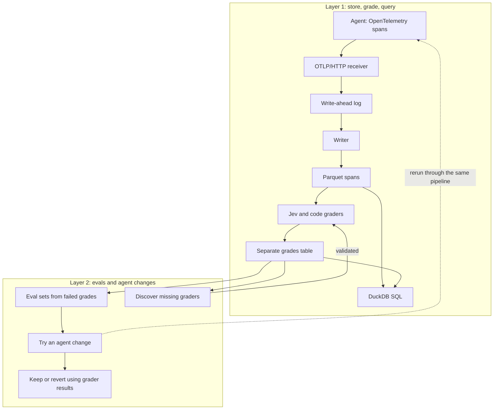

# hopper-mini

A laptop-scale trace store for AI agents. An agent emits OpenTelemetry spans, a receiver durably logs each upload, and a writer converts the log into Parquet files that DuckDB queries. Background graders turn trace quality into searchable data.

The project explores whether evaluations can work as indexes over agent traces, and what ingestion, storage, queries, and grading cost at 10,000, 100,000, and 1 million traces.

**Status:** design stage. The application and `hopper` CLI are not implemented yet. The architecture, commands, and targets below describe the intended system.

## What we want to measure

- How fast can spans arrive, how long until they are queryable, and what survives a process crash?
- How many bytes does a span cost in the raw log and in Parquet?
- When does precomputing grades cost less than judging traces at query time?
- Can failed grades produce useful eval sets, reveal missing graders, and guide agent changes?

## Architecture

### Layer 1: store, grade, query

1. **Emit.** Each agent request produces a trace containing model calls, tool calls, and nested agent spans. The OpenTelemetry SDK exports batches to `POST /v1/traces` on `127.0.0.1:4318` using OTLP/HTTP protobuf, optionally compressed with gzip.
2. **Acknowledge durably.** The receiver validates the upload and appends its original bytes to a checksummed write-ahead log. It acknowledges only after the group fsync covers that upload. Backpressure returns `429`; an append failure returns `503`.
3. **Write Parquet.** One writer reads up to the log's durable end, deduplicates retries within a ten-minute window, and flattens spans into rows. It flushes about every two seconds. Files are fsynced under a temporary path, renamed into place, and followed by a directory fsync. Filenames record the covered log offsets so the writer can resume after a crash.
4. **Query.** DuckDB reads the immutable Parquet files directly. Views expose spans, whole traces, grades, and traces with grade columns. The planned CLI provides `hopper sql`, `hopper trace`, and `hopper find`.
5. **Grade.** Background workers grade finished traces and append their answers to separate Parquet files, partitioned by grader. Late spans trigger regrading.

Span rows use typed columns for IDs, timestamps, status, models, tokens, and tool names. JSON columns retain attributes, events, links, and resource attributes. Drawing images are recorded by reference instead of embedded as base64.

The WAL is the replay source. Parquet is the durable query storage; DuckDB supplies the query engine. There is no separate database catalog in the initial design.

### Grades as an index

Grades are rows under `grades/grader=<name>/`, so adding a grader appends data without rewriting span files. A `trace_grades` view presents grades as columns for queries. Grader versions coexist while a new version is backfilled.

The seed graders ask whether the answer addresses the question, is grounded in retrieved text, and is actionable. A code grader checks that the answer cites at least one document and that every cited ID exists.

Jev returns probabilities that map to `yes`, `no`, or `unsure`. A missing grade means ungraded, never `no`. Layer 2 uses validated graders. Seed Jev graders require at least 85% agreement on at least 50 human labels.

### Layer 2: close the loop

Layer 2 reuses the same trace store, grades, and ingestion pipeline:

- Build eval sets from failed grades, with regression guards and a deterministic split by task into training and held-out cases.
- Discover graders for failures the existing graders missed, validate them, and backfill their grades.
- Try bounded changes to agent prompts or tool descriptions, rerun the agent, and keep or revert changes using the same graders.

An answer-key checker provides a separate quality signal. It helps identify grader blind spots and reports whether grader gains correspond to task success. It does not select eval cases or score them. Held-out case content stays out of optimizer and discovery prompts.

## The agent is the workload

The initial agent answers construction requests for information, or RFIs, about a fictional pump-station upgrade. It triages a question, researches specifications, drawing sheets, and addenda with tools, and submits an answer with citations.

The corpus includes conflicting documents, changed requirements, calculations, and questions that require escalation to an engineer. Follow-up questions and seeded tool errors produce realistic conversations, retries, and failure spans.

Real agent runs produce the seed traces. A replay generator sends those traces through the same receiver with fresh IDs, shifted timestamps, and controlled delivery faults. Replays reuse seed grades, allowing larger storage and query experiments without more model calls. Storage benchmarks distinguish repeated payloads from salted replays that make message content unique.

## Targets, not results

These are acceptance targets to test during implementation. No project benchmark results are available yet.

| Area | Target |
| --- | --- |
| Ingestion | At least 10,000 spans per second into the WAL from one receiver process |
| Freshness | p99 acknowledgment-to-queryable latency of at most 10 seconds at 2,000 spans per second |
| Crash recovery | After 20 process kills during a 100,000-trace replay, every acknowledged span appears exactly once |
| Grading lag | p99 finished-trace-to-last-Jev-grade latency of at most 60 seconds |
| Storage | Seed traffic in Parquet uses at most 25% of its raw OTLP bytes |
| Grade filtering | A two-grade filter at 1 million traces completes in under one second warm and reads only the two relevant grader folders |
| Adding a grader | At 100,000 traces, appended grades write at most 1% of the bytes a grade column would require rewriting |
| Grader coverage | Every finished seed trace has every applicable current grade |

Benchmarks will also report acknowledgment latency, storage by column, query bytes and row groups scanned, grading cost, and the break-even query count for precomputed grades. Layer 2 will report held-out changes with a paired 95% confidence interval alongside the checker's pass rate.

## Build plan

The intended stack is Python 3.12 managed with `uv`, OpenTelemetry, DuckDB, PyArrow, Anthropic for the agent and change proposals, and TypeSafe's Jev for model grading. Linting and tests will use Ruff and pytest. Unit tests will mock model providers at the client boundary.

The planned configuration uses these environment variables:

| Variable | Purpose |
| --- | --- |
| `ANTHROPIC_API_KEY` | Anthropic API access |
| `TYPESAFE_API_KEY` | TypeSafe API access for Jev |
| `HOPPER_DATA_DIR` | Generated data directory, defaulting to `~/hopper-data` outside the repository |
| `HOPPER_SPEND_CAP_USD` | Model spend limit per data directory, defaulting to `20` |
| `HOPPER_ENDPOINT` | OTLP trace export endpoint |

Every real model call will go through a spend ledger. API keys belong in the local environment, outside version control.

| Milestone | Deliverable |
| --- | --- |
| M0 | Project setup, CLI, configuration, and spend ledger |
| M1 | WAL and OTLP receiver |
| M2 | Parquet writer, data verification, and query commands |
| M3 | Corpus, RFI agent, checker, seed traffic, and replay |
| M4 | Grader workers, grade views, labels, validation, and coverage |
| M5 | Ingestion, crash recovery, storage, query, and grading benchmarks with a report |
| M6 | Eval sets and runs built from grades |
| M7 | Grader discovery, validation, and backfill |
| M8 | Bounded agent improvement loop and final report |

## Initial scope

The stack runs on one laptop for one user, with a localhost receiver and one writer. Distributed deployment, multi-tenancy, authentication, and a UI are outside the initial scope.

Blob extraction, message deduplication, file compaction, writer sharding, full-text indexing, and second-opinion grading wait until measurements justify them.
