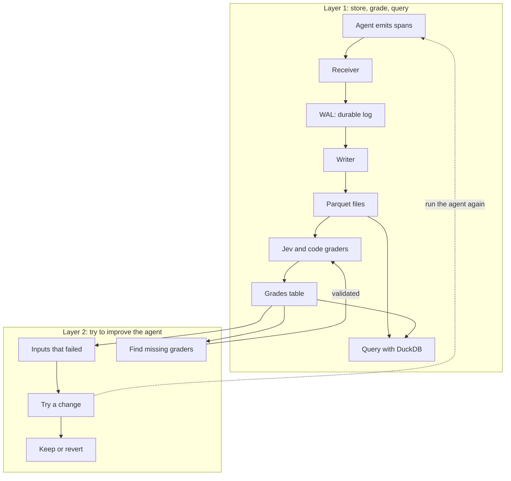

# hopper-mini

I want to use this repo to explore a mini trace ingestion stack for agents. An agent does some work, makes model and tool calls, and emits spans. The spans from one request make up a trace.

This is all a mini version of what an actual production system might do. The idea is to run it on a laptop and understand how the pieces fit together.

## How it fits together

## Layer 1: store, grade, query

The basic flow is:

1. The agent sends its spans to an endpoint using OpenTelemetry.
2. The receiver writes each upload to a write-ahead log, or WAL, and acknowledges it once it is on disk.
3. The writer reads the log, turns spans into rows, and writes batches to Parquet files.
4. DuckDB reads those files so we can query a whole trace, look at tool calls, or find errors.
5. Jev and code graders look at finished traces and write their answers to a separate grades table.

The log keeps the original uploads so we can replay them. Parquet gives us compressed files that DuckDB can query directly.

## Why keep grades separately?

I want to see whether we can grade traces once and then search using those grades. For example, show me traces where the agent answered the question but made claims its sources do not support.

Graders ask questions about the trace and record `yes`, `no`, or `unsure`. A trace with no grade yet is still ungraded. We check the graders against labels before using them to judge agent changes.

Grades live in a separate table. Adding a grader means adding rows, without rewriting all the span files.

## Layer 2: try a change and see if it helps

Take inputs from traces that got bad grades and save them as an eval set. Change a prompt or some tool text, run those inputs again, and let the same graders judge the results. Use that to decide whether to keep the change or revert it.

We also look for mistakes the current graders missed. Those can become new grader questions, which we check before using them.

Every rerun goes through the same receiver, log, writer, and graders. A separate answer-key checker helps us see whether better grades actually mean better answers.
