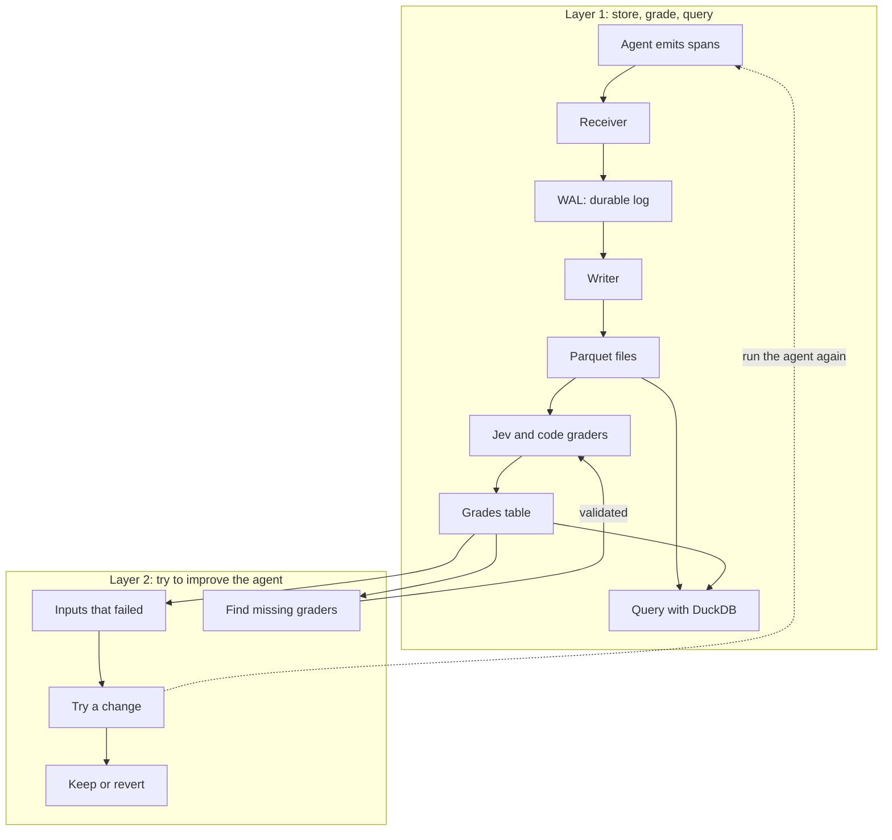

# hopper-mini

I want to use this repo to explore a mini trace ingestion stack for agents. An agent does some work, makes model and tool calls, and emits spans. The spans from one request make up a trace.

This is all a mini version of what an actual production system might do. The idea is to run it on a laptop and understand how the pieces fit together.

## How it fits together



## Layer 1: store, grade, query

The basic flow is:

1. The agent sends its spans to an endpoint using OpenTelemetry.
2. The receiver writes each upload to a write-ahead log, or WAL, and acknowledges it once it is on disk.
3. The writer reads the log, turns spans into rows, and writes batches to Parquet files.
4. DuckDB reads those files so we can query a whole trace, look at tool calls, or find errors.
5. Jev and code graders look at finished traces and write their answers to a separate grades table.

The log keeps the original uploads so we can replay them. Parquet gives us compressed files that DuckDB can query directly.

## Why keep grades separately?

I want to see whether we can grade traces once and then search using those grades. For example, show me traces where the agent answered the question but made claims its sources do not support.

Graders ask questions about the trace and record `yes`, `no`, or `unsure`. A trace with no grade yet is still ungraded. We check the graders against labels before using them to judge agent changes.

Grades live in a separate table. Adding a grader means adding rows, without rewriting all the span files.

## Layer 2: try a change and see if it helps

Take inputs from traces that got bad grades and save them as an eval set. Change a prompt or some tool text, run those inputs again, and let the same graders judge the results. Use that to decide whether to keep the change or revert it.

We also look for mistakes the current graders missed. Those can become new grader questions, which we check before using them.

Every rerun goes through the same receiver, log, writer, and graders. A separate answer-key checker helps us see whether better grades actually mean better answers.

## Receive traces

Run the OTLP/HTTP receiver in the foreground:

```sh
hopper ingest serve
hopper ingest serve --fsync per-request
hopper ingest serve --full-fsync
```

`--full-fsync` uses macOS `F_FULLFSYNC`. The default uses group commit. `HOPPER_ENDPOINT` defaults to `http://127.0.0.1:4318` and must be an HTTP loopback origin.

To run the receiver under local supervision, use:

```sh
hopper stack up
hopper stack status
hopper stack down
```

These commands print JSON. `up` waits for its receiver to open the WAL and bind the listener. A failed first start cleans up the supervisor. After a successful start, the supervisor restarts a crashed receiver with a retry delay capped at one second. `down` stops restarts and gives the owned receiver five seconds to drain before sending SIGKILL. If the supervisor dies, its receiver detects the closed parent connection and drains. Logs are in `$HOPPER_DATA_DIR/.stack/supervisor.log`.

Send `POST /v1/traces` with `Content-Type: application/x-protobuf` and optional `Content-Encoding: gzip`. The receiver keeps the original body, including gzip bytes. HTTP 200 contains an empty `ExportTraceServiceResponse` and follows the WAL's durable receipt. Empty protobuf requests are valid. Each span needs a 16-byte trace ID and an 8-byte span ID.

Invalid protobuf, gzip, or IDs return 400. Unsupported content types or encodings return 415. Bodies above 32 MiB after decompression, or too large for one WAL record, return 413. Pressure returns 429 with `Retry-After: 1`. Storage failures return 503 and stop the receiver so supervision can recover it. Error bodies use protobuf `google.rpc.Status`.

The receiver allows eight active uploads and ten seconds to read a body. Uploads retain their capacity through validation and durable completion, even after client disconnects. Admission stops after backlog exceeds 256 MiB or pending WAL frames would exceed 64 MiB. Backlog includes admitted frames waiting for fsync and uses a writer position sampled every 250 ms, so the estimate can temporarily overstate backlog. One request may cross the backlog threshold. Until a writer commits Parquet files, accepted uploads accumulate in the WAL.

`GET /healthz` reports liveness, admitted `backlog`, and `sampled_physical_backlog`. Validation and pressure rejections are not appended. Clients may retry uploads whose acknowledgements were lost, so duplicates can exist after a disconnect or crash.

Run `PYTHONPATH=src .venv/bin/pytest -q -s tests/test_edge.py tests/test_stack.py` for the exporter round trip, HTTP errors, pressure, and process crash checks.

## Inspect the local log

`hopper.wal` stores original uploads in checksummed segments. An append returns a future that completes after the record and durable marker are synced. The default group commit syncs every 5 ms or 1 MiB. `Wal.open(data_dir, fsync="per-request")` syncs each record separately. On macOS, `full_fsync=True` also flushes the drive cache with `F_FULLFSYNC`.

Commands use `HOPPER_DATA_DIR`, which defaults to `~/hopper-data`:

```sh
hopper wal stat
hopper wal tail --limit 10
hopper wal prune --retention 7
```

`stat` prints JSON with segment count, stored bytes, physical and durable ends, writer position, backlog, and the first retained offset. `tail` prints JSON Lines with offsets, the UTC receipt time, content type, gzip flag, and `body_base64`. The body remains opaque, including compressed bytes. Both inspect only the captured durable snapshot and work while the appender is open.

`prune` removes whole closed segments whose end is covered by committed `spans/<start>-<end>.parquet` files. The newest segment stays as the offset anchor. Retention is a nonnegative number of days and defaults to seven. `--retention 0` skips the age requirement.

Use `with read_records(data_dir, start) as records:` to read a finite durable snapshot from a known record offset. Close the context when stopping early. Snapshots use one segment descriptor at a time, allow appends, and make `prune` report busy until they close.

Run the local benchmark from the checkout:

```sh
PYTHONPATH=src .venv/bin/python benchmarks/bench_wal.py --records 10000 --writers 8 --window 64
PYTHONPATH=src .venv/bin/python benchmarks/bench_wal.py --full-fsync --profile
```

The benchmark alternates five trials per mode using 64-byte bodies. It prints records per second, p50 and p99 append-to-completion latency observed by callbacks, verified records, errors, and median and range summaries. Each trial reads every record back and checks its payload, offsets, and per-writer order. `--profile` adds separate diagnostic trials that count and time real synchronization calls. Those diagnostic trials do not contribute to the throughput summary. Results describe this local WAL path, not receiver throughput or power-loss testing.

Run `HOPPER_WAL_MILLION=1 PYTHONPATH=src .venv/bin/pytest -q tests/test_wal.py::test_million_individual_concurrent_records_with_real_fsync` for the million-record concurrency and readback acceptance test. Normal test runs skip this larger case.
